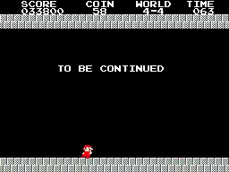

# All-stage playthrough

[Watch or download the full walkthrough (MP4, 10:26, with game audio).](all-stages.mp4)

`tests/all-stages.pad` is a controller recording starting at power-on, not a
save state or a list of stage-select writes. It plays 1-1 through 4-4 in order.
The game has no permanent win screen: after the last castle message it starts
1-1 again. The replay stops just after that transition.

## Reproduce on Linux

Use the tested Genesis Plus GX libretro revision. No BIOS, display server,
audio device or network access is needed to *run* the tests. In addition to
the ROM build tools you need a C compiler and the core's build prerequisites.
For example, from the Superboyqol directory:

```sh
core=/tmp/superboy-gpgx
mkdir -p "$core"
curl -fLsS https://codeload.github.com/libretro/Genesis-Plus-GX/tar.gz/b9c2316441978d4015ba30e9a95d9b0e6f8ee981 \
  | tar -xz -C "$core" --strip-components=1
make -C "$core" -f Makefile.libretro -j2
make replay GPGX="$core"
```

`make replay` first compares the rebuilt cartridge with the reference. It then
runs two independent cold boots in the unmodified emulator core:

1. **All clear.** Run the recorded inputs frame by frame. The frontend reads
   the stage index, life counter, actor-enable and demo flags from system RAM.
   Each stage must advance to its immediate successor, show a non-uniform
   picture during play and keep the original five lives. The 16th clear must
   wrap to stage zero. A truncated movie, skipped stage or blank display fails.
2. **Failure path.** Start 1-1 and stop pressing buttons. Observe all five BCD
   countdowns reaching zero, the lives counting down, the game-over reset to
   five lives and visible attract-mode play. This path is deliberately not in
   the successful movie.

The frontend selects **NTSC-U**. This is significant on the tested core:
its automatic region for this cartridge can start work RAM filled with `$f0`.
The game enables interrupts during video setup *before* it clears work RAM;
with that power-on state the game logic can run while the screen stays blank.
The replay test samples video as well as RAM for this reason. Leave region and
emulator revision unchanged when comparing frame numbers.

## Recording format and scope

Each line is `frame_count buttons`, where `L`/`R` are directions, `1`/`2` are
SMS buttons 1/2 (RetroPad B/A), and `-` is neutral. Hold the entire combination
for that many video frames, then read the next line. No BIOS/menu input is
part of the recording. The route was found by trying controller sequences with
emulator checkpoints; **replay itself never loads a checkpoint or changes RAM**.
This validates a complete route through all stages, not every possible branch,
item, or collision in every stage.

## Verified result



The complete movie is **37,510 frames** (10:26 at 59.9227 Hz). These are the
frames when the stage index actually changed, not estimates based on the video:

| World | Round 1 | Round 2 | Round 3 | Round 4 |
|---|---:|---:|---:|---:|
| 1 | 2,625 | 5,449 | 7,147 | 9,062 |
| 2 | 11,519 | 13,353 | 15,262 | 16,810 |
| 3 | 19,774 | 22,629 | 24,571 | 26,299 |
| 4 | 29,382 | 33,046 | 34,831 | 37,475 |

As a separate disassembly check, the two tests were also run with a local
instruction-fetch probe (mark the PC immediately before `ROP()` in the core's
`z80_run`). The successful movie visited 3,938 distinct instruction starts;
the idle test visited 2,355. All **4,023 distinct addresses** in the union
matched decoded Z80 instructions. The clear route included the `$4e19` bonus
area; the idle route included `$742a` (time over), `$745c` (game over) and
`$5caf` (demo input). This measures exercised code, not all code in the ROM.
