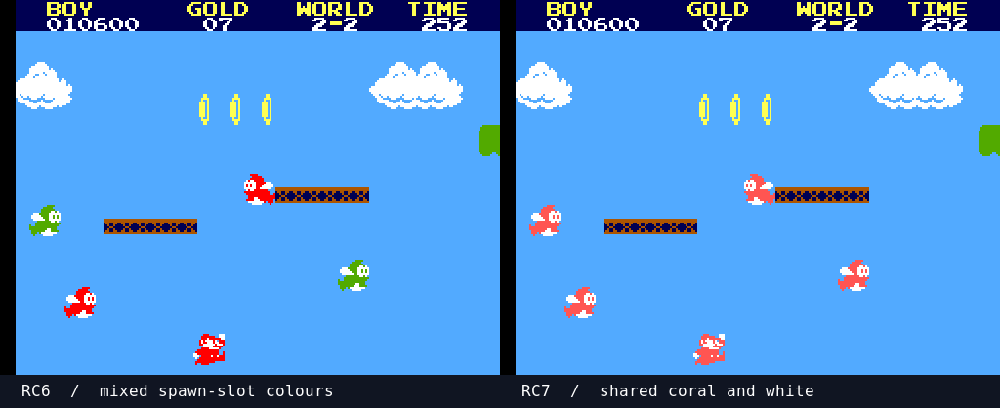

# Generic polish playtest (RC7)

[Download the standalone SMS ROM](../releases/superboy-generic-polish-rc7.sms) · [Watch the opening with game audio](polish-opening.mp4) · [Stable v0.3.1](generic.md)

This build keeps the balanced Generic layouts. Try running at full speed and
pressing the opposite direction, then try the same turn near a ledge. The
player now brakes **through** the old velocity instead of freezing while two
opposing speeds cancel out. Account for about one tile of skid from a full
run. Walking speed, short-hop release and full jump height are unchanged.
When powered up, **2** fires on press; letting go of run no longer wastes a shot.

Bricks and ground have highlighted edges. In RC2, the face of each live question
block cycles **bright gold → amber → dark copper → amber**, then repeats.
Each shade lasts eight gameplay ticks. The question-mark ink stays black;
spent blocks, other scenery, sprites and HUD colours stay unchanged. Each
stage sheet reserves one background palette entry for the pulse; no map,
collision, or per-block tile updates are needed.
Four PSG cues distinguish bumping a brick from breaking it, enemy contact
from collecting a coin, and earning an extra life from an ordinary pickup.
They borrow the effects voice rather than stopping the stage music.

## Shared sprite colours (RC7)



The four short-enemy slots that share this artwork now use coral and white
regardless of spawn order. Tall green-and-white enemies keep leaf-green
accents on both body halves instead of switching to red below the waist.
The player's outfit, mushroom cap, flower petals and fireballs use the same
coral; gold and white highlights stay distinct. These are **sprite** colours:
level scenery, the HUD and the question-block pulse use their own palette.
Star invincibility still deliberately cycles the player's inks.

The paired screenshots are from frame 16,320 of the same controller recording.
RC7 keeps the existing RC6 replay inputs, including the 16-stage campaign.

## Faster running and stars

Hold **2** and a direction: at full speed you now cover 72 pixels in 32
logic ticks instead of 64 (2.25 instead of 2 pixels/tick). The extra pixel
gets its own wall probe; the game does not speed up jump physics or enemies.

Six question blocks now hold stars: one each in **1-1, 1-2, 2-1, 3-1,
4-1 and 4-2**. In 1-1, hit the low question block between two bricks in the
middle of the course (layout column 124). The star rises, then moves right.
Touch it to cycle the player’s colours and defeat ordinary enemies on contact
for **480 gameplay ticks** (about eight seconds on NTSC). It doesn’t grant
size or fire, and pits and timeouts still work normally. Protection ends
when the timer expires or a stage reloads.

[Watch the fast star theme and a fireball knockout with game audio](polish-star-fire.mp4).

- **Colour:** the player cycles through eight two-colour palettes, one every
  two gameplay ticks. The rest of the screen keeps its usual colours.
- **Impact:** contact turns the enemy’s own sprite upside down and launches
  it away from the player. It rises, falls, and can’t hurt the player or
  block a projectile during the arc. Tall enemies flip as a whole body.
- **Music:** *Comet Run* is an original four-bar PSG loop with a quick lead,
  octave bass and a quieter offbeat counterline. In RC6 all three staves
  play at tempo 248 instead of 184. The stage clock no longer slows them
  down every 32 ticks. Pickup cuts off the previous sound; jumps, coins and
  impacts cannot borrow a voice or queue up for later. At expiry the stage
  theme restarts and ordinary sound effects work again.

The star regression checks all three score channels keep their fast tempo and
the effects voice stays inactive. It also observes colour changes, an
inverted enemy rising 30 px and travelling 78 px horizontally, the return
of the stage music, and an enemy damaging the player after expiry.

## Mushroom and fire flower blocks (introduced in RC3)

In 1-1, the lone first question block always pays a coin. The first low
question block in the brick row just beyond it always holds an upgrade.
There are **16 mushroom/flower blocks across the 12 non-castle stages**. Contents
are keyed to the block’s level column and row, not the jump timing, camera
phase, or the order in which you hit blocks. Death/retry restores them.

- **Small:** a mushroom rises out of the block, starts moving right, turns at
  walls and falls off edges. Collect it to grow.
- **Big or already able to shoot:** a fire flower rises and stays on the
  block. Collect it while big to enable fire. If you took damage after it
  appeared, collecting it restores size instead.
- **Firing:** press **2** with the flower to shoot. A fireball bursts on
  impact; a vulnerable enemy flips upside down and arcs in the shot’s
  direction, even if the player has turned around. Fireproof enemies still
  stop the shot without being knocked back.
- The block is spent when it releases its item. The game has one pickup
  slot: hitting another upgrade block while that slot is occupied leaves
  the second block intact rather than paying out a coin or deleting the item.

[Watch the mushroom and fire flower pickups](polish-power-ups.mp4). The
controller-only regression collects both in 1-1: it observes the mushroom
travel 72 pixels and the emerged flower stay still for 86 frames while the
camera moves, then a fireball launching an enemy 30 pixels up and 78 pixels
horizontally. The asset build also checks that every listed location really
contains both halves of a question block.

## Measured on Genesis Plus GX (NTSC-U)

| Same cold boot and input | v0.3.1 | RC7 |
| --- | ---: | ---: |
| Start press to active 1-1 | 38 frames | 20 frames |
| First leftward pixel after reversing a full rightward run | frame 18 | frame 10 |
| Forward travel during that reversal | 0 px (stall) | 8 px (skid) |
| Frames with opposing velocities in the reversal | 15 | 0 |
| Six-frame / held jump height | 19 / 79 px | 19 / 79 px |

The start benchmark checks **all 704 tiles** of the title and first playable
window against ROM data. Full screens decode directly to their final columns.
During a full stage prime, the engine no longer shifts a 704-byte buffer for
each column before anything can be seen. Mixed openings and live streaming
retain the original path. A full clear writes each physical playfield row in
one burst and leaves the HUD untouched. Stage cards need only 5 × 256 bytes
of background tiles instead of 32 × 256; the 2 KiB HUD font stays resident.
The card itself (world, player and life count) is still displayed.

## Reproduce

```sh
make polish                             # build/superboy-polish.sms
make verify generic                     # stock still matches its original
cmp build/superboy-generic.sms releases/superboy-generic-v0.3.1.sms
cmp build/superboy-polish.sms releases/superboy-generic-polish-rc7.sms
make polish-test GPGX=/path/to/Genesis-Plus-GX
build/replay releases/superboy-generic-v0.3.1.sms --opening  # A/B baseline
```

Use GNU Make, SjASMPlus 1.21.1, Python 3 and the [pinned emulator for tests](playthrough.md).
RC7 SHA-256: `630b79cc4ce15873aee7b664d790cc05ddaf4304be49a1127d3258b86b963506`.
The focused checks cover movement, the opening benchmark, two rendered question-block colour cycles, fine scrolling with
a fixed HUD, scrolling enemies and coin popups, and five timeouts through
game over and attract mode. The controller recording
`tests/polish-all-stages.pad` then clears all 16 stages from reset: the recording ends back at 1-1 on
frame 43,169 with five lives. This is a different route from v0.3.1’s recording,
not a benchmark of total loading time. Physical hardware has not been tested.

## Next playtest priorities

- **Late jumps:** log missed takeoffs on the longer gaps before adding coyote
  time or buffered jumps. Both would affect the difficulty beyond the 1–2
  tile landing adjustments already in v0.3.1.
- **Busy scenes:** count dropped actor scanlines on hardware in the castle
  stages. If shots or hazards disappear, prioritize those over coin sparkles.
- **Sound mix:** compare rapid bumps and pickups over each world theme on a
  console PSG before changing their priority or extending the cues.
- **Transitions:** measure the mixed cave openings and retries independently;
  the 18-frame saving above is for starting 1-1, not a campaign-wide average.
